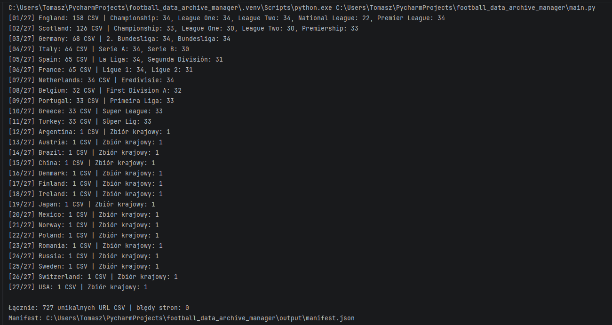
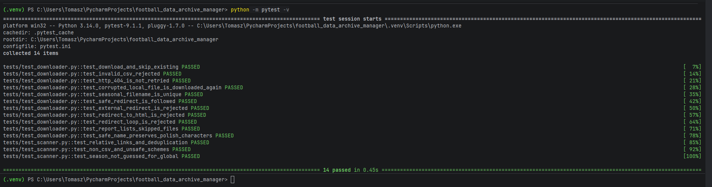
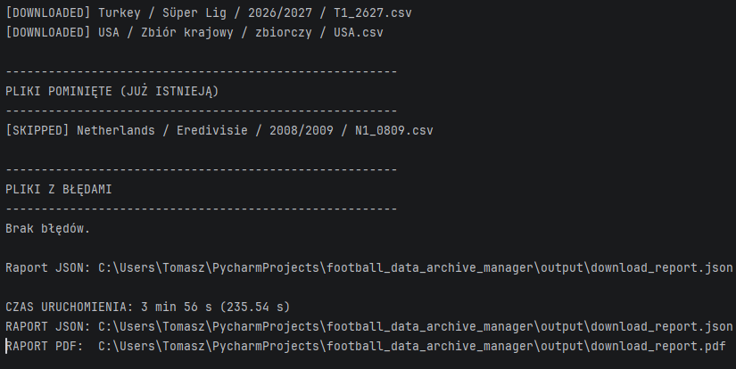
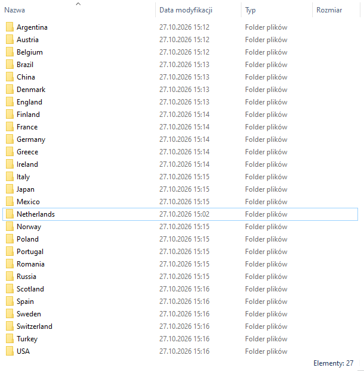
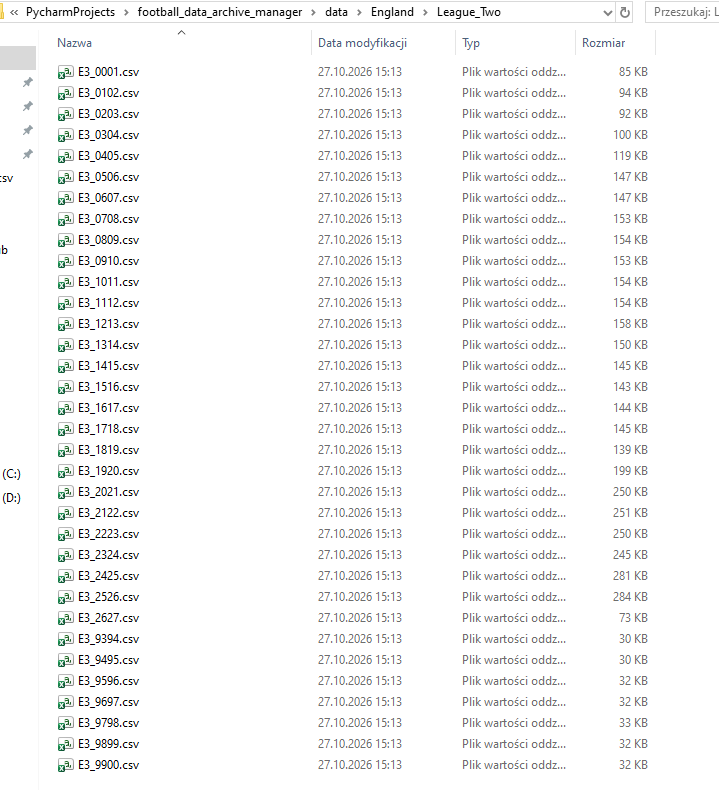
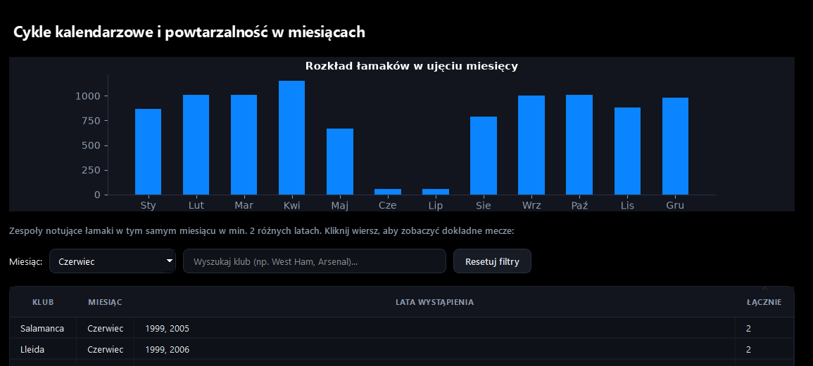
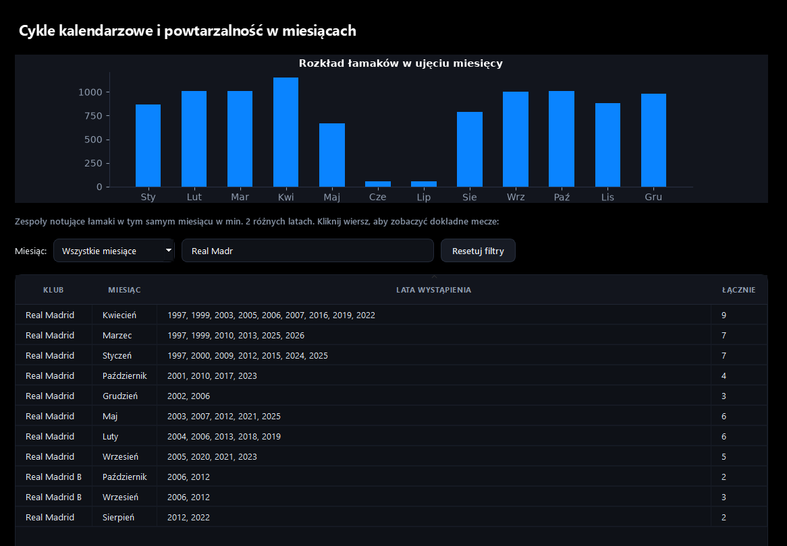
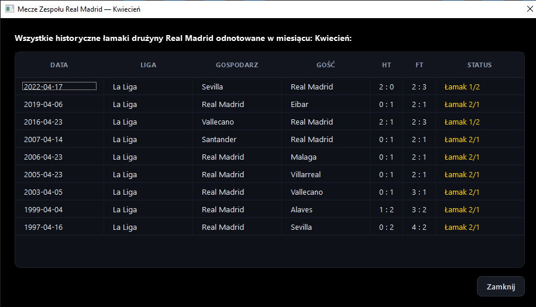

# Automatyzacja pozyskiwania i weryfikacji danych sportowych

**Python · automatyzacja · kontrola jakości danych · raportowanie**

> **Publiczne studium przypadku.** Kod źródłowy, adresy stron i szczegóły źródeł pozostają prywatne, ponieważ rozwiązanie jest wykorzystywane w innym rozwijanym projekcie. Grafiki przedstawiają schematy opracowane na potrzeby portfolio, a nie zrzuty witryny źródłowej.

## 1. Problem

Historyczne dane sportowe były rozproszone pomiędzy wieloma stronami, kategoriami rozgrywek i sezonami. Ręczne zebranie plików CSV oznaczałoby powtarzalne otwieranie stron, wyszukiwanie odnośników, zapisywanie plików i kontrolowanie, które zasoby zostały już pobrane.



W pierwszym etapie program przeanalizował **27 stron źródłowych** i wykrył **727 unikalnych adresów plików CSV**. Wszystkie 27 stron zostało przetworzonych bez błędu skanowania. Liczby dotyczą wykrytych odnośników, a nie liczby rekordów wewnątrz plików.

## 2. Cel

Celem było stworzenie narzędzia, które samodzielnie wykrywa dostępne pliki, porządkuje informacje o nich, pobiera dane, sprawdza ich integralność i pozwala bezpiecznie wznowić przerwaną pracę — bez ponownego pobierania poprawnych plików.

## 3. Rozwiązanie

**Etap 1 — skanowanie.** Program analizuje strony, wyszukuje odnośniki do CSV, normalizuje adresy i usuwa duplikaty.

**Etap 2 — manifest JSON.** Zidentyfikowane zasoby są opisywane metadanymi: kategorią, rozgrywkami, sezonem (jeśli można go ustalić), nazwą pliku oraz lokalizacją źródłową. Manifest jest zapisywany lokalnie. **Rzeczywiste adresy URL nie są publikowane.**

**Etap 3 — pobieranie.** Program korzysta z manifestu, zapisuje pliki w uporządkowanych katalogach, obsługuje wybrane błędy HTTP i bezpieczne przekierowania oraz zapisuje stan operacji.

**Etap 4 — weryfikacja.** Podstawowa kontrola zawartości CSV oraz suma kontrolna SHA-256 pozwalają odrzucać nieprawidłowe odpowiedzi i rozpoznawać zmienione pliki. Wyniki trafiają do raportu JSON.

## 4. Przykład struktury danych

Poniższy fragment jest **schematem**, a nie rzeczywistym manifestem ani ujawnieniem nazw plików źródłowych:

```text
data/
├── Kategoria_A/
│   └── Rozgrywki_1/
│       ├── sezon_2023_2024.csv
│       └── sezon_2022_2023.csv
└── Kategoria_B/
    └── Rozgrywki_2/
        └── sezon_2023_2024.csv
```

## 5. Testy i kontrola jakości

Do testów jednostkowych wykorzystano `pytest`. Sprawdzane scenariusze obejmują m.in.:

| Scenariusz | Oczekiwane działanie |
|---|---|
| Plik istnieje i jego suma SHA-256 jest zgodna | Pominięcie ponownego pobrania |
| Plik lokalny został zmodyfikowany | Ponowne pobranie |
| Serwer zwraca HTTP 404 | Zgłoszenie niepowodzenia |
| Zamiast CSV otrzymano HTML | Odrzucenie odpowiedzi |
| Przekierowanie prowadzi poza dozwolone źródło | Zablokowanie przekierowania |
| Przekierowanie tworzy pętlę | Wykrycie pętli |
| Nazwa zawiera polskie znaki | Zachowanie znaków Unicode |

**Rzeczywisty wynik testów:**


## 6. Rezultaty



**[Zobacz przykładowy raport PDF](reports/raport01.pdf)**

## 7. Organizacja pobranych danych

Pobrane pliki CSV są automatycznie zapisywane w uporządkowanej strukturze katalogów, z podziałem na kraje i rozgrywki. Pozwala to łatwo odnaleźć dane historyczne bez konieczności ręcznego sortowania plików.

**Podział archiwum według krajów**



**Przykładowe archiwum rozgrywek League Two**



## 8. Praktyczne wykorzystanie danych (analiza historycznych wyników)

Zgromadzone dane mogą być wykorzystywane nie tylko do archiwizacji, ale również do dalszej analizy statystycznej. Przykładem jest opracowany przeze mnie moduł analizujący tzw. **łamaki (HT/FT)**, czyli spotkania, w których drużyna przegrywająca do przerwy ostatecznie wygrywa mecz.

Moduł umożliwia wyszukiwanie historycznych wyników, analizowanie ich rozkładu w poszczególnych miesiącach oraz identyfikowanie zespołów, u których takie zdarzenia występowały w tym samym miesiącu w różnych latach.

### 1. Analiza powtarzalności w miesiącach



Możliwość filtrowania danych według miesiąca i wyszukiwania zespołów, dla których określony wzorzec występował w co najmniej dwóch różnych latach.

### 2. Wyszukiwanie i analiza konkretnego zespołu



Wyszukiwanie klubu i zestawianie miesięcy, w których odnotowano historyczne przypadki odwrócenia wyniku meczu. Tabela przedstawia lata wystąpienia wzorca oraz liczbę zarejestrowanych zdarzeń.

### 3. Weryfikacja wyników na poziomie pojedynczych spotkań



Po wybraniu interesującego zestawienia możliwy jest podgląd konkretnych meczów wraz z datą, rozgrywkami, uczestniczącymi drużynami, wynikiem do przerwy (HT), wynikiem końcowym (FT) oraz typem odwrócenia wyniku (1/2 lub 2/1).

Rozwiązanie prezentuje praktyczne zastosowanie przetwarzania danych historycznych, filtrowania wielokryterialnego, agregacji wyników oraz tworzenia interaktywnych zestawień analitycznych.

*Przedstawione wzorce mają charakter opisowy i nie stanowią potwierdzenia przewidywalności przyszłych wyników sportowych.*

